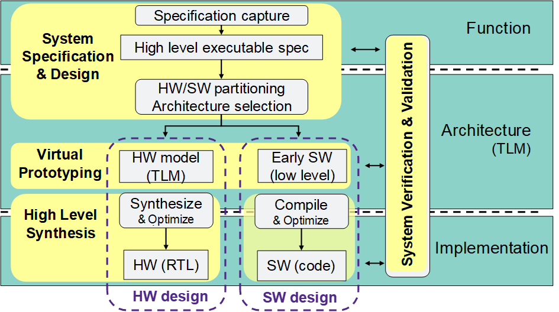
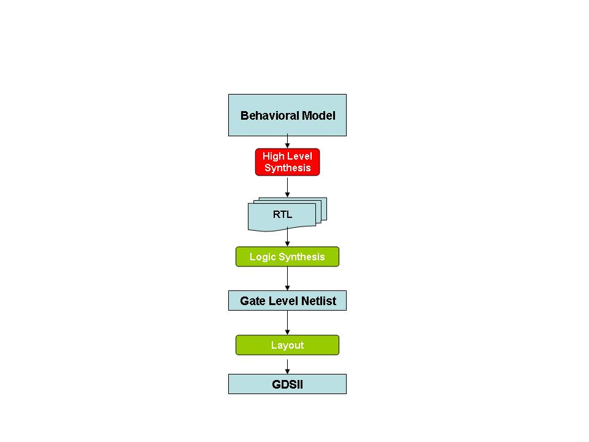
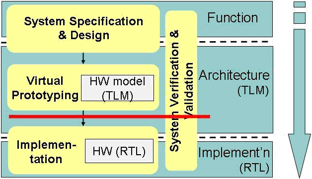
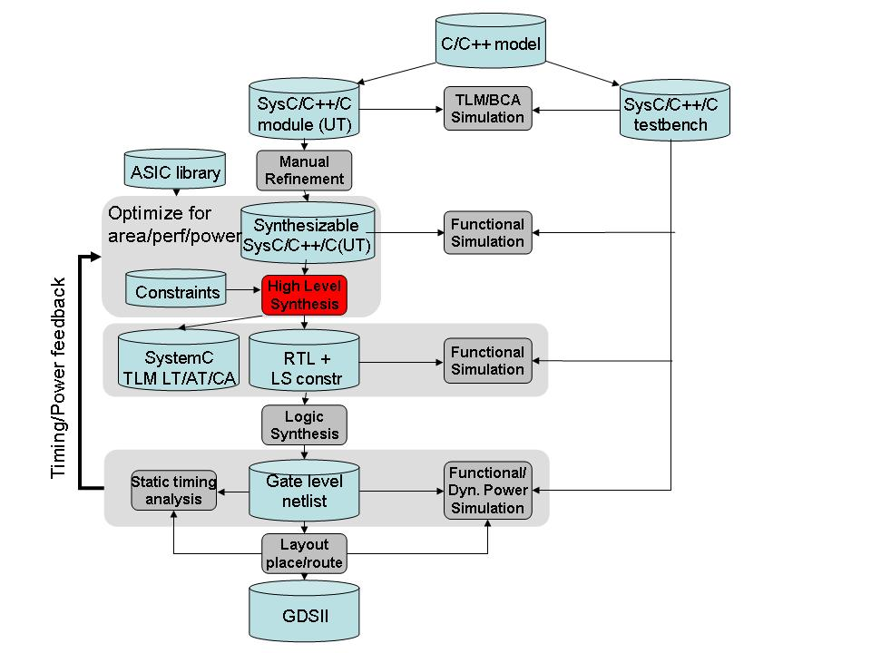

<!-- REVIEW:
    1- This Annex contains dated material which is not consistent with the current scope of the document. Propose we drop it, or add a short rationale section to the introduction. See below for more feedback.
-->

# Annex A (Informative): Levels of Abstraction in SystemC Design and Introduction to High-level Synthesis

## Introduction to Abstraction Levels

**How abstraction levels support design activities**

The complexity of modern systems does not allow us to design such systems directly without modeling
at a number of abstraction levels. Furthermore, it is difficult to create derivative implementations
with different functions or different architectures, because functions and architectures cannot be
extracted easily from implementations for re-use.

System designers utilize a separation of function, architecture, and implementation to manage these
issues, with design activities at each level of abstraction. It is possible to distinguish three
main levels of abstraction: function level, architecture level, and implementation level.
Each level has its own standards and methodologies.
The SystemC synthesizable subset defines a standard set of language constructs for describing a
System at the implementation level.

<!-- REVIEW:
    2- This is not a synthesizable subset document anymore, and limiting it to the implementation level excludes use cases such as using SystemC models for functional (and synthesizable) models.
-->

Figure A.1 shows one representation of the abstraction levels in a System Design Flow.



**Figure A.1** Abstraction levels in a System Design Flow

The abstraction levels include:

1.  The Function level in which the algorithms are defined and the system is partitioned into
    communicating tasks.

2.  The Architecture level in which the tasks are assigned to execution units, communication
    mechanisms between the execution units are defined, and implementation metrics, such as
    performance, are modeled and estimated.

3.  The Implementation level in which the precise method of implementation of the execution units is
    defined.

The Implementation level is further subdivided:

1.  The Implementation Behavior level in which the implementation is specified in terms of an
    algorithm embodied in an implicit state machine.

2.  The Implementation Register Transfer Level in which the implementation is specified in terms of
    a combination of combinatorial logic and an explicit state machine.

3.  The Implementation Gate Level in which the implementation is specified in terms of technology
    leaf cells

## Introduction to high-level synthesis

This section is focused on synthesis solutions that generate non-programmable register-transfer
level (RTL) cores from high-level descriptions.

<!-- REVIEW:
    3- Limiting this to non-programmable RTL cores is too restrictive for the scope of this document.
-->


*High-Level Synthesis* (HLS), also known as *Behavioral Synthesis*, allows designing at a level of
abstraction higher than the register-transfer level by automating the translation and optimization
of a behavioral description, or a high-level model, into an RTL implementation. It also transforms
un-timed or partially timed functional models into fully timed RTL implementations.

Because a micro-architecture is generated automatically, designers can focus on designing and
verifying the module functionality. Design teams create and verify their designs in less time
because it eliminates the need to fully schedule and allocate design resources, as done with
existing RTL methods. This behavioral design flow increases design productivity, reduces errors, and
speeds up verification. Figure A.2 shows an abstract view of a representative design flow involving
High-Level synthesis and Logic synthesis.




**Figure A.2** Abstract view of design flow involving High-Level and Logic synthesis

A typical high-level synthesis process incorporates a number of complex stages. This process starts
with a high-level language description of a module's behavior, including I/O actions and
computational functionality. Several algorithmic optimizations are performed to reduce the
complexity of a result and then the description is analyzed to determine the essential operations
and the dataflow dependencies between them.

The other inputs to the high-level synthesis process typically include a target technology library
and a set of directives that will influence the resulting architecture. These directives include,
for example, timing constraints used by the algorithms of a *<u>synthesis tool</u>* as they create a
cycle-by-cycle schedule of the required operations. In some flows, a set of low-level components is
characterized at a target frequency for the selected fabrication process. This characterized library
is used when allocation and binding occurs, in order to assign these operations to specific
functional units, such as adders, multipliers, comparators, etc.

Finally, a state machine is generated that will control the resulting datapath to implement the
desired functionality. The datapath and state machine outputs are RTL code optimized for use with
conventional simulation and logic synthesis or physical synthesis tools.

<!-- REVIEW:
    4- The above paragraphs, without the figure, are good candidates for the introduction section.
-->

To be useful to system designers, SystemC-based HLS typically needs to accommodate two different
semantics of timing.

- Portions of a *<u>design</u>* are described in a time-independent manner - allowing the
  *<u>synthesis tool</u>* to schedule operations for specific clock cycles.

- Portions of a *<u>design</u>* are described in a timing accurate matter - allowing the user to
  specify the cycle-accurate protocol a portion of a system uses to communicate with the rest of the *<u>design</u>*.

These two competing requirements pose challenges for verification. The SystemC language has no
constructs to distinguish where cycle-accuracy is intended and where a *<u>synthesis tool</u>* has
degrees of freedom to re-order operations. The practical implication of this is there is no
guarantee the pre-synthesis simulation of a *<u>design</u>* will match the post-synthesis simulation
of the resulting RTL. The large body of existing techniques in testbench design and verification
methodology which experienced designers use to validate functional correctness is beyond the scope
of this document.

In practice, existing *<u>synthesis tools</u>* have adopted tool-specific methodologies for
expressing when a segment of code is intended to be treated as cycle-accurate. Standardizing how
these blocks of code should be specified is beyond the current scope of this standard, but is a
fertile area for future standardization efforts.

<!-- REVIEW:
    5- The previous paragraph explicitly refers to cycle accurate models. Are we going to support cycle accurate models?
-->

## Vision for high-level design

<!-- REVIEW:
    6- This section is dated (e.g. its references to TLM and its abstraction levels) and its wish list is outside the scope of this standard. Propose we drop it.
-->

Easier management of system complexity, accelerated design verification and implementation,
increased opportunity for design reuse, and a wider selection of implementation options, these are
just a few reasons why project teams are moving to high-level design. However, by moving to the
higher levels of abstraction, a design gap between HLS and RTL has come into existence.

For each algorithm modelled at abstract level, there are numerous ways it can be realized in
hardware. However, with tight schedules and increasing complexity, there simply is not enough time
to create more than one RTL implementation by hand after an algorithm and architecture choice is
made. This way, alternative hardware implementation options that could significantly impact
performance, area, or power are seldom created or evaluated.

With the availability of a general-purpose language based on C++, like SystemC, and the maturity of
high-level synthesis and verification tools, high-level models can be leveraged to help evaluate
trade-offs in architectures and algorithms in ways not previously possible.

Figure A.3 shows the vision for synthesizing from architecture to RTL. Components in the architecture are described in synthesizable SystemC and interfaced and connected using the TLM library.



**Figure A.3** The vision from architecture (TLM) to implementation (RTL)

Figure A.4 shows a possible implementation flow from Electronic System Level (ESL) down to GDSII.
Based on this diagram, a wish list of requirements (beyond the scope of this standard) for ESL
Synthesis solutions based on C/C++/SystemC can be defined:

- Automate the RTL implementation from behavioral C/C++/SystemC (TLM) models
- Support a fast design time (implementation & Verification)
    - At least a 2x improvement compared to hand coded design
- Support optimization for Performance, Area, and Power
    - On par or better area results for a required performance compared to hand coded
    - Automatic timing closure based on back-annotated static timing analysis
    - Automatic power optimization based on dynamic power simulation
- Support the generation of behavioral SystemC TLM models with timing annotation (LT/AT) and SystemC
  CA models
- Automate reuse of high-level test environment for verification of RTL implementation, netlist, and
  generated SystemC TLM views
    - Support of assertions
    - Support for functional equivalence checking
- Support synthesis from and generation of TLM 2.0 SystemC compliant models
- Full integration of high-level synthesis methodology in a System-Level Design Environment

**Figure A.4** Abstract view of possible implementation flow from ESL down to GDSII

## Abstraction Level Details

<!-- REVIEW:
    7- This section is out of scope of the document. It mentions commercial tools and languages (Matlab) and refers to methodologies which may or may not be applicable to all domains. Suggest we drop this.
-->

## Function Level

The motivation for introducing this level of abstraction is to quickly obtain a function to
determine what the system is supposed to do, without making architecture assumptions.
Hence, there is the potential to re-use functions either to create derivative functions or to
synthesize different implementations with different architectures.

An example of a view at this level is a function modelled as a process network which can be analyzed
through simulation.

At the Function Level of abstraction, two design steps can be identified:

- Algorithm Specification

- Partitioning into communicating tasks

## Function Level: Algorithm Specification

T0

In this design step, an executable functional specification of the algorithm is created (e.g., in
C/C++/Matlab code). This executable specification is used to check the validity of the algorithm.
The simulation in this design step is sequential, it has no timing information, and it has a single
thread of control. The simulation speed is high due to lack of timing and architecture details.

- Profiling techniques are used to obtain an initial estimate of the computational load of the
different functions and the amount of data transfer between them.

- Code inspection is used to estimate the amount of flexibility required for each of the functions.
The results of both, code inspection and profiling, are used as input for task partitioning and, in
a later stage, as input for hardware/software partitioning.

- Next to algorithm verification, the executable functional specification generated in this step is
also used as a golden reference model throughout the whole flow.

## Function Level: Partitioning into communicating tasks

<!-- REVIEW:
    8- We should not limit this HLS standard to a specific model of computation (e.g. KPNs mentioned here), or imply that HLS is limited to them.
    9- Additionally, the section refers to the external YAPI library, which is out of scope of this document.
-->

With the design constraints and requirements, a suitable architecture template in mind, and the
results from the previous algorithm design step, the system is partitioned into tasks that perform
processing functions and channels through which data is communicated between these tasks.

The processes in such a network are concurrent and are connected by communication channels.
Processes produce data elements and send them along a unidirectional communication channel where
they are stored in a first-in-first-out order until the destination process consumes them.
Such a network is also referred to as a Kahn Process Network (KPN) (Kahn, 1974).

In KPN, parallelism and communication are explicitly modeled, which is essential for the mapping
onto multi-processor systems. Another property of KPN is that an application designer can combine
processes into networks without specifying their order of execution. This property stimulates the
modular construction and reuse of applications (functional IP), since it is easier to compose new
applications using existing ones.

Using a multi-threaded simulation, the communication load on the channels and the computation load
on the tasks are analyzed. If necessary, the system can be repartitioned to meet the constraints and
requirements. Also, the functional correctness of the partitioning is checked during the
multi-threaded simulation.

To model signal processing applications as Kahn Processing Networks \[5\], YAPI \[6\] \[7\] can be
used. The purpose of YAPI is to enable the reuse of signal processing applications and the mapping
of signal processing applications onto heterogeneous systems that contain hardware and software
components.

YAPI has also been embedded in SystemC. YAPI embedded in SystemC is developed as a SystemC class
library with a set of rules that can be used to model stream processing applications as a
process network. As mentioned above, the model of computation in YAPI is based on KPN.

Function level is also known as behavioral architectural-level \[8\] \[9\]\]. At this level, for the
equation *Y* = *P*(*X*), both *X* and *Y* contain no time. As soon as any *x<sub>i</sub>* of *X*
changes value, then *P* computes *Y* at exactly the same instance. A virtual clock can be the only
one or one of the *x<sub>i</sub>* of *X*. When the virtual clock triggers the process, *P* computes
*Y* based on *X* at exactly the same instance.

This can be modeled in SystemC using *SC_METHOD*s, *SC_THREAD*s, or *SC_CTHREAD*s.

Example 1: using SC_METHOD:

```cpp
SC_MODULE( AddMul_2 ) {
    sc_in <sc_uint<16>> a, b, c;
    sc_out<sc_uint<32>> result;

    void addmul_2() {
        result = a.read() + (b.read() * c.read());
    }

     SC_CTOR( AddMul_2 ) {
        SC_METHOD( addmul_2 );
        sensitive << a << b << c;
    }
};
```

In the above example, the process function *P* is addmul_2(); the input set is
*X* = {*x<sub>1</sub>*, *x<sub>2</sub>*, *x<sub>3</sub>* }, where *x<sub>1</sub>* = a,
*x<sub>2</sub>* = b and *x<sub>3</sub>* = c; the output set is *Y* = {*y<sub>1</sub>*}, where
*y<sub>1</sub>* = result.

####

Example 2: using SC_CTHREAD:

```cpp
SC_MODULE( AddMul_3 ) {
    sc_in<bool> clk;
    sc_in<bool> rst;
    sc_in<sc_uint<16>> a, b, c;
    sc_out<sc_uint<32>> result;

    void addmul_3() {
        result = 0;
        wait();
        while (1) {
            result = a.read() + (b.read() * c.read());
            wait();
        }
    }

    SC_CTOR( AddMul_3 ) {
        SC_CTHREAD( addmul_3, clk.pos() );
        reset_signal_is(rst, false);
    }
};
```

In the above example, the process function *P* is the combination of void addmul_3() and the
semantics of *SC_CTHREAD* and *reset_signal_is()*.
Furthermore, clk and rst ports are identified as sensitive events, and clk is the clock port and rst
the reset port. The input set is *X* = {*x<sub>1</sub>*, *x<sub>2</sub>*, *v<sub>1</sub>*,
*v<sub>2</sub>*, *v<sub>3</sub>*}, where *x<sub>1</sub>* = clk, *x<sub>2</sub>* = rst,
*v<sub>1</sub>* = a, *v<sub>2</sub>* = b and *v<sub>3</sub>* = c. The output set is
*Y* = {*y<sub>1</sub>*}, where *y<sub>1</sub>* = result.

## Architecture Level

<!-- REVIEW:
    10- The wording of this section is unclear (e.g. the dictionary definition of "transaction" in terms of "goods"). Suggest we drop it.
-->

The motivation for introducing this level of abstraction into a design flow is to quickly find an
efficient implementation. Efficiency can be defined in terms of power, timing, area, etc. To be able
to quickly evaluate the efficiency of alternative implementations, it is desirable to avoid the
effort of making them in detail. For example, the decision to base an implementation on a message
passing or a shared memory architecture leads to two alternative implementations.

Transaction Level Modeling (TLM) was developed for abstract modeling of (SoC) systems at the
architecture level, allowing efficient system exploration. Literally, a *<u>transaction</u>* is the
exchange of goods, services or funds; or a communicative action or activity involving two parties or
things that reciprocally affect or influence each other (Merriam-Webster Online Dictionary).
Both meanings have two ingredients, exchange/communication and goods/influence.

In an electronic system, the goods or influence can be considered as the computation (goods) or the
effect of the computation (influence).
There have been many discussions regarding TLM over the years; here, the definitions, terminologies,
and libraries developed by the OSCI TLM Working Group (TLM WG) are used.

## Transaction Level Modeling

<!-- REVIEW:
    11- The UT, LT, AT and CA coding styles are not mentioned anywhere else in this document, so this is out of scope. Suggest we drop this section.
-->

Although TLM includes computation and communication, TLM-1 and TLM-2.0 in the SystemC LRM only
describes the communication part. In TLM-1 and TLM-2.0, a transaction is a payload, the data
structure that passed between modules. The SystemC LRM considers the following coding styles for
transaction-level modelling:

1. Un-Timed (UT): A modeling style in which there is no explicit mention of time or cycles, but
   which includes concurrency and sequencing of operations. In the absence of any explicit notion of
   time as such, the sequencing of operations across multiple concurrent threads shall be
   accomplished using synchronization primitives such as events, mutexes, and blocking FIFOs. Some
   users adopt the practice of inserting random delays into untimed descriptions to test the
   robustness of their protocols, but this practice does not change the basic characteristics of the
   modeling style.

2. Loosely Timed (LT): A modeling style that represents minimal timing information, sufficient only
   to support the features necessary to boot an operating system and manage multiple threads in the
   absence of explicit synchronization between those threads. A loosely timed model may include
   timer models and a notional arbitration interval or execution slot length. Some users adopt the
   practice of inserting random delays into loosely timed descriptions to test the robustness of
   their protocols, but this practice does not change the basic characteristics of the modeling
   style.

3. Approximately Timed (AT): A modeling style for which there exists a one-to-one mapping between
   the externally observable states of the model and the states of some corresponding detailed
   reference model such that the mapping preserves the sequence of state transitions, but not their
   precise timing. The degree of timing accuracy is undefined.

4. Cycle Accurate (CA): A modeling style in which it is possible to predict the state of the model
   in any given cycle at the external boundary of the model and, thus, establish a one-to-one
   correspondence between the states of the model and the externally observable states of a
   corresponding RTL model in each cycle, but which is not required to explicitly re-evaluate the
   state of the entire model in every cycle or explicitly represent the state of every boundary pin
   or internal register. This term is only applicable to models that have a notion of cycles.

In this document, UT modules represent an abstraction that aligns well with the synthesizable subset
described herein. LT modules use absolute time for timing information and, thus, are not
synthesizable (e.g., it is infeasible to synthesize sc_time(10, SC_NS), which is used to represent
the latency to execute a certain function). AT modules are not synthesizable as well, because states
and state transitions modelled using AT are not precise in timing. The CA modeling style is not
addressed in detail in the SystemC LRM.

## Implementation Level

<!-- REVIEW:
    12- This section only repeats the abstraction levels and is out of scope of this document. Suggest we drop it.
-->

This abstraction level captures the details of the interfaces and the I/O functionality, including a
full or partial specification/modelling of their timing. The communication among blocks is carried
out at the signal-level. The specification of the interface is pin-accurate and should be preserved
by synthesis for the top-level module. Implementation levels include Register-Transfer Level (RTL),
Gate Level, and Behavioral-Level. RTL and Gate Level are widely used and have traditionally been
written in hardware description languages, such as Verilog/VHDL and SystemVerilog.
The abstraction level below Gate Level is expressed in the GDSII format. SystemC is not suitable for
this abstraction level.

## Implementation Gate Level

<!-- REVIEW:
    13- SystemC is not used at the gate level (as said below), so this is out of scope. Suggest we drop this section.
-->

The Gate Level consists of interconnection of instantiations of technology leaf cells.
The specification is structural. The behavior of each cell is written for simulation and is
generally quite simple. For example, combinational gates are typically written in the form of
concurrent statements. Sequential gates, including registers and memories, are usually written in
the same form as it is done at the RTL level.

SystemC is not generally used to represent gate-level constructs.

## Implementation RT Level

<!-- REVIEW:
    14- This is a general RTL tutorial and the example is not related to any rule in this document. Suggest we drop this section.
-->

Register Transfer Level (RTL), as the name suggests, describes functions and signals from registers
to registers. The basic elements of this level are combinational and sequential functional/logic
units, registers, and signals.

An RTL module has a Finite State Machine (FSM) which describes cycle-by-cycle behavior of the target
module. The functional behavior of each state can be described inside the FSM. This kind of FSM can
be called an FSM with Datapath (FSMD). Or the functional behavior can be described using a separate
datapath which is then controlled by the FSM.

The RT level allows the specification of both structural and more behavioral constructs.

- In addition to bit-wise logic, word-level arithmetic, such as a \* b can be specified and
  synthesized.

- Loops with constant number of iterations can be specified. Such loops are fully unrolled.

- An FSM can be specified in such a way that synthesis can recognize it as an FSM and perform
  optimizations, such as state encoding, etc. The computation of the next-state and the output is
  done with behavioral constructs, such as if-then-else and case statements.

- An FSM, where states and transitions *<u>may</u>* contain complex logic and arithmetic behavior
  (not just simple constant assignments to outputs), is constructed as an explicit-state machine.
  Registers *<u>may</u>* be specified either inside or outside the explicit-state machine.

The interface of RTL sub-blocks *<u>may</u>* be changed by synthesis (boundary optimization), but
the top-level interface is preserved. Clock, reset and enable behavior is explicitly specified.
Internal cycle timing of operations *<u>may</u>* be changed in limited ways (retiming) under user control.

The verification methodology of the output from RTL synthesis against the reference RTL
specification is well defined for both combinational and sequential hardware.
For instance, IEEE Standard 1076-2004 defines this for VHDL and the same methodology is applicable
for SystemC RTL specifications.

Example:

```cpp
SC_MODULE( AddMul_1 ) {
    sc_in<bool> clk;
    sc_in<sc_uint<16>> a, b, c;
    sc_out<sc_uint<32>> result;

    void addmul_1() {
        result = a.read() + (b.read() * c.read());
    }

     SC_CTOR( AddMul_1 ) {
        SC_METHOD( addmul_1 );
        sensitive << clk.pos();
    }
};
```

In the above example, *P* is the function void addmul_1(); *X* = {*x<sub>1</sub>*, *v<sub>1</sub>*,
*v<sub>2</sub>*, *v<sub>3</sub>*}, where *x<sub>1</sub>* = clk, *v<sub>1</sub>* = a,
*v<sub>2</sub>* = b and *v<sub>3</sub>* = c; *Y* = {*y<sub>1</sub>*}, where
*y<sub>1</sub>* = result.

## Implementation Behavioral-Level

<!-- REVIEW:
    15- The implicit state machine concept is important for HLS input and is not explained elsewhere. Suggest we move it to the introduction.
-->

The behavioral-level introduces some freedom in how operations and I/O are scheduled by only
partially constraining the cycle-by-cycle behavior of the I/O. Registers are not explicitly defined,
but instead are determined by synthesis. Storage requirements are dependent on how operations are
scheduled: registers are used to store values that are used one or more cycles after the cycle in
which they are generated. Storage of arrays *<u>may</u>* be mapped to memories or registers.

The specification of behavior is in the form of an implicit-state machine rather than the
explicit-state machine generally used for RTL. In an implicit-state machine, there is no explicit
state variable that is used to select what behavior is executed next. Instead, the behavior consists
of a process that is sensitive to the clock and possibly a reset signal (for asynchronous resets).
The process uses language constructs, such as loops, constructs to continue and exit loops, and
constructs to specify conditional behavior (if-then-else and case constructs) and wait statements
that specify cycle timing among sets of output assignments.

The output from behavioral synthesis is a synthesizable RTL description and/or a Gate-Level
description. The verification methodology of the generated specifications against the behavioral
(source) specification is more complex (than the RTL level vs. Gate-Level specification) since the
cycle-by-cycle behavior *<u>may</u>* be changed by synthesis.
